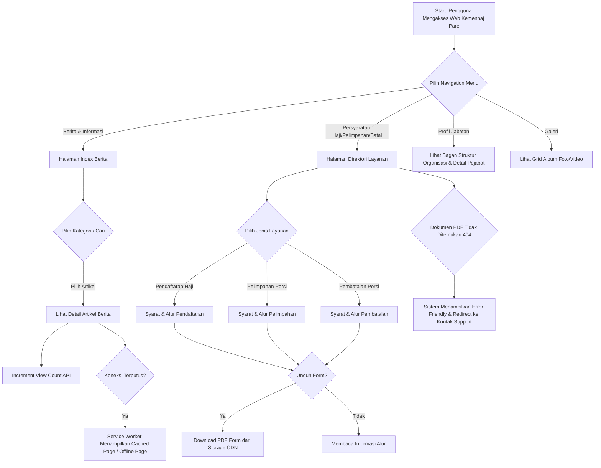
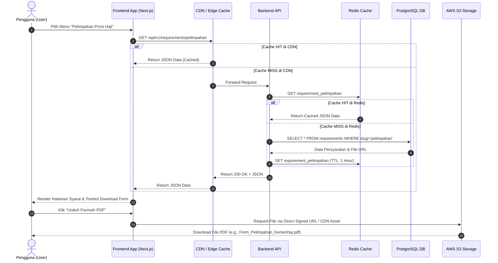
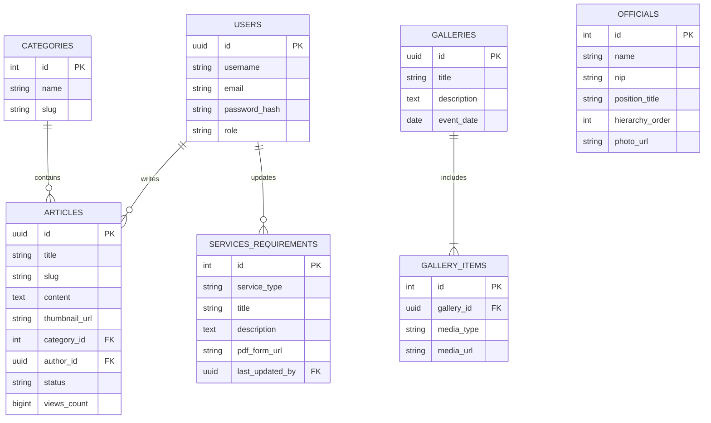

# PRODUCT REQUIREMENT DOCUMENT (PRD)

| Metadata | Detail |
| :--- | :--- |
| **Nama Produk** | Portal Informasi Publik Kementerian Haji dan Umrah Kota Parepare |
| **Dokumen Versi** | 1.0.0 |
| **Status** | Approved for Development |
| **Penulis** | Senior Technical Product Manager & Principal Software Engineer |
| **Target Launch** | Q4 2026 |

---

## 1. OVERVIEW

### 1.1 Executive Summary
Portal Informasi Publik Kementerian Haji dan Umrah Kota Parepare (Kemenhaj Pare) dirancang sebagai *one-stop digital gateway* berstandar pemerintah untuk transparansi publik, edukasi prosedur, serta publikasi kegiatan operasional. Aplikasi berbasis web ini bertujuan untuk menyajikan berita populer dan terkini, profil struktur organisasi/jabatan resmi, alur & persyaratan administratif (pendaftaran haji, pelimpahan porsi, dan pembatalan porsi), serta dokumentasi kegiatan berupa galeri multimedia secara responsif, aman, dan dapat diakses dengan cepat oleh seluruh lapisan masyarakat Parepare.

### 1.2 Problem Statement & Goals
*   **Problem Statement:**
    1. Masih tingginya ketidakpastian informasi publik terkait prosedur formal administratif haji/umrah (persyaratan pelimpahan, pembatalan, dan pendaftaran) yang memicu antrean berkas dan kesalahan dokumen saat pengajuan fisik.
    2. Kurangnya saluran digital terpusat untuk publikasi berita terkini dan transparansi pejabat/struktur organisasi Kantor Kemenag/Kemenhaj Kota Parepare.
    3. Belum adanya repositori dokumentasi kegiatan (galeri) terstruktur yang terindeks dengan baik untuk kebutuhan akuntabilitas publik.
*   **Goals & Key Success Metrics (KPIs):**
    *   **Kecepatan Akses Informasi:** 90% pengguna dapat menemukan persyaratan lengkap layanan haji/umrah dalam waktu < 2 menit tanpa bantuan petugas fisik.
    *   **Performance & Page Speed:** Skor Google Lighthouse > 90 pada *Core Web Vitals* (LCP < 2.5 detik, FID < 100 ms, CLS < 0.1).
    *   **Adopsi Pengguna:** Mencapai minimal 5,000 *Monthly Active Users* (MAU) unik pada 6 bulan pertama pasca-rilis.
    *   **Uptime & Handal:** Availability minimum 99.9% *uptime* per bulan.

### 1.3 Scope & Out-of-Scope
*   **In-Scope:**
    *   Modul Berita & Pengumuman (Trending, Kategori, Search, SEO Friendly).
    *   Modul Profil & Struktur Organisasi (Hierarki Jabatan, Tugas Pokok, Foto Pejabat).
    *   Modul Layanan Informasi Persyaratan (Haji Reguler/Khusus, Pelimpahan Porsi, Pembatalan Porsi, Download Form PDF).
    *   Modul Galeri Kegiatan (Foto & Video Album, Tagging).
    *   Modul Content Management System (CMS Admin) berbasis peran (RBAC) untuk manajemen konten internal.
    *   Sistem pencarian terintegrasi (*Full-Text Search*).
*   **Out-of-Scope (Fase 1):**
    *   Sistem pendaftaran haji/umrah *online transactional* secara langsung (tetap merujuk ke Sistem SISKOHAT Kementerian Agama RI).
    *   Integrasi *Payment Gateway* untuk biaya pelimpahan/batal (proses keuangan tetap melalui Bank Penerima Setoran / BPS-BPIH).
    *   Aplikasi Mobile Native (iOS/Android) — difokuskan pada *Progressive Web App* (PWA) / Responsive Web.

---

## 2. REQUIREMENTS

### 2.1 Functional Requirements

#### A. Modul Publik (Guest User)
*   **FR-PUB-01 (Layanan Informasi Persyaratan):** Sistem wajib menampilkan dokumen panduan, syarat formal, dan alur prosedur untuk Pendaftaran Haji, Pelimpahan Porsi, dan Pembatalan Porsi lengkap dengan fitur unduh formulir PDF.
*   **FR-PUB-02 (Berita & Informasi):** Sistem wajib menyajikan berita terkini dan populer, dikategorikan secara intuitif, serta mendukung navigasi *pagination* dan *infinite scroll*.
*   **FR-PUB-03 (Profil Struktur Jabatan):** Sistem wajib menampilkanbagan organisasi interaktif, daftar nama pejabat beserta unit kerja, tugas, dan nomor kontak resmi.
*   **FR-PUB-04 (Galeri Multimedia):** Sistem wajib menyajikan galeri foto dan video beresolusi terkompresi dengan fitur modal viewer/lightbox.
*   **FR-PUB-05 (Pencarian Terpadu):** Sistem wajib menyediakan *search bar* terpusat yang mampu mencari berita, syarat dokumen, dan album galeri secara paralel.

#### B. Modul Admin (CMS Panel)
*   **FR-ADM-01 (Authentication & RBAC):** Sistem wajib menyediakan otentikasi aman (2FA opsional) dengan 3 *role*: `Super Admin`, `Editor Berita`, dan `Staff Layanan`.
*   **FR-ADM-02 (Manajemen Konten / WYSIWYG):** Admin wajib dapat membuat, mengedit, menjadwalkan, dan menghapus artikel/berita dengan rich text editor serta penanganan alur *draft-review-publish*.
*   **FR-ADM-03 (Manajemen Dokumen Persyaratan):** Admin wajib dapat memperbarui syarat dan mengunggah template PDF formulir resmi.
*   **FR-ADM-04 (Manajemen Media/Galeri):** Admin wajib dapat melakukan *batch upload* gambar dengan pemrosesan *auto-compression* dan penanganan *watermark*.

### 2.2 Non-Functional Requirements

*   **Performance:**
    *   *Response Time:* API response time (p95) < 200 ms untuk query read.
    *   *Throughput:* Mampu menangani beban puncak (*peak load*) hingga 1,000 *concurrent users*.
    *   *Asset Optimization:* Format gambar menggunakan `WebP`/`AVIF` otomatis via CDN.
*   **Security:**
    *   Wajib menerapkan enkripsi HTTPS/TLS 1.3 secara menyeluruh.
    *   Perlindungan standar OWASP Top 10 (CSRF Protection, XSS Sanitization, SQL Injection Prevention, Rate Limiting pada API).
    *   Role-Based Access Control (RBAC) ketat pada seluruh endpoint API backend.
*   **Scalability & Architecture:**
    *   *Stateless Backend Architecture* untuk mempermudah *horizontal scaling* (Auto-scaling group).
    *   Prinsip *Separation of Concerns* antara Frontend (PWA) dan Backend API.
*   **Availability & SLA:**
    *   Target SLA Availability 99.9% (Maksimal *downtime* toleransi ~43 menit per bulan).
    *   Disaster Recovery Plan: *Daily Automated Database Backup* dengan *Retention Policy* 30 hari di S3 Cold Storage.

---

## 3. CORE FEATURES & MOSCOW PRIORITIZATION

| ID Fitur | Nama Fitur | Deskripsi | Prioritas MoSCoW | Acceptance Criteria (Given-When-Then) |
| :--- | :--- | :--- | :--- | :--- |
| **FT-01** | **Pusat Syarat Layanan Haji & Pelimpahan/Batal** | Halaman khusus direktori syarat lengkap (Haji, Pelimpahan Porsi karena Meninggal/Sakit Permanen, Pembatalan Porsi) beserta berkas formulir PDF yang dapat diunduh. | **Must Have** | **Given** Pengguna berada di halaman Layanan.<br>**When** Pengguna memilih menu "Pelimpahan Porsi Haji".<br>**Then** Sistem menampilkan daftar dokumen wajib, alur proses 5 langkah, dan tombol "Unduh Formulir PDF" yang dapat diunduh langsung. |
| **FT-02** | **Portal Berita Terkini & Populer** | Dashboard berita dengan algoritma sorting berdasarkan tanggal rilis (Terkini) dan jumlah pembaca (Populer). | **Must Have** | **Given** Pengguna membuka Landing Page.<br>**When** Sistem memuat konten.<br>**Then** Menampilkan 3 Berita Populer teratas dan *feed* Berita Terkini dengan tag *kategori* serta estimasi waktu baca. |
| **FT-03** | **Profil & Struktur Organisasi** | Tampilan visual hierarki jabatan, nama pejabat resmi, NIP, serta gambaran tugas fungsi Kantor Kemenhaj Pare. | **Must Have** | **Given** Pengguna mengakses menu Profil.<br>**When** Pengguna mengeklik salah satu Kotak Jabatan (misal: Kepala Seksi PHU).<br>**Then** Sistem menampilkan *pop-up/card* detail profil, tugas pokok, dan kontak pelayanan resmi. |
| **FT-04** | **Galeri Dokumentasi Kegiatan** | Grid album foto & video kegiatan pelayanan haji dengan fitur filter berdasarkan tahun/kategori. | **Should Have** | **Given** Pengguna berada di halaman Galeri.<br>**When** Pengguna mengeklik salah satu thumbnail album foto.<br>**Then** Modul Lightbox terbuka menampilkan gambar resolusi tinggi dengan deskripsi dan tanggal kegiatan. |
| **FT-05** | **Pencarian Global (Global Search)** | Bilah pencarian di header untuk pencarian cepat kata kunci di seluruh konten portal. | **Should Have** | **Given** Pengguna mengetikkan kata kunci "Pelimpahan" di Search Bar.<br>**When** Pengguna menekan *Enter* atau tombol Cari.<br>**Then** Sistem menampilkan hasil pencarian yang terbagi atas kategori Berita, Persyaratan, dan Galeri dalam waktu < 500ms. |
| **FT-06** | **PWA & Offline View Form** | Dukungan PWA agar informasi persyaratan yang sudah pernah dibuka dapat diakses secara *offline*. | **Could Have** | **Given** Pengguna telah membuka syarat pembatalan saat online.<br>**When** Pengguna kehilangan koneksi internet dan membuka kembali halaman tersebut.<br>**Then** Halaman tetap tampil utuh dari *cache* Service Worker. |
| **FT-07** | **Live Chat Bot FAQ** | AI Chatbot interaktif untuk menjawab pertanyaan seputar persyaratan haji. | **Won't Have (Fase 1)** | *Dipertimbangkan untuk pengembang lanjutan pada Fase 2.* |

---

## 4. USER FLOW

### 4.1 Global User Flow (Happy Path & Edge Cases)



---

## 5. ARCHITECTURE & INFRASTRUCTURE

### 5.1 High-Level Architecture
Sistem dibangun menggunakan pola **Jamstack / Decoupled Architecture** untuk performa tinggi, keamanan maksimal, dan beban server yang efisien.

```
+-----------------------------------------------------------------------------------+
|                                 CLIENT LAYER                                      |
|  [ End User Web Browser / PWA ] <-------> [ Edge CDN / Cloudflare Cache ]          |
+-----------------------------------------------------------------------------------+
                                          |
                                          v
+-----------------------------------------------------------------------------------+
|                                API GATEWAY LAYER                                  |
|  [ NGINX Reverse Proxy / Rate Limiting / TLS Termination / WAF ]                  |
+-----------------------------------------------------------------------------------+
                                          |
                                          v
+-----------------------------------------------------------------------------------+
|                               APPLICATION LAYER                                   |
|  +----------------------------------+    +-------------------------------------+  |
|  | Frontend Application (Next.js)   |    | Backend API Service (Go / Node.js)  |  |
|  | - SSR / SSG Rendering Engine     |    | - RESTful API / GraphQL             |  |
|  | - Service Worker / Cache Manager |    | - Auth RBAC Module                  |  |
|  +----------------------------------+    +-------------------------------------+  |
+-----------------------------------------------------------------------------------+
       |                                      |                        |
       v                                      v                        v
+--------------------+              +--------------------+   +----------------------+
|  DATABASE LAYER    |              |   CACHING LAYER    |   |   STORAGE LAYER      |
|  [ PostgreSQL DB ] |              |   [ Redis Cache ]  |   | [ AWS S3 / MinIO ]   |
|  (Relational Data) |              | (Session/API Cache)|   | (Media, PDF Forms)   |
+--------------------+              +--------------------+   +----------------------+
```

### 5.2 Strategi Caching, Queue, & Deployment
*   **Caching Strategy:**
    *   **CDN Level:** Static assets (JS, CSS, Images, PDF) dicache di Edge CDN dengan TTL 7 hari.
    *   **Application Level (Redis):** Hasil query API publik (Berita populer, Struktur Organisasi, Persyaratan) di-*cache* di Redis. Invalidation cache otomatis terpicu saat Admin melakukan *Update/Delete* data di CMS.
*   **Queue System:**
    *   Menggunakan **Redis/BullMQ** untuk proses latar belakang (*background jobs*), seperti pemrosesan kompresi gambar saat upload galeri dan pembuatan *thumbnail* PDF.
*   **Deployment & Infrastructure:**
    *   **Containerization:** Docker & Docker Compose untuk pengkapsulan environment.
    *   **CI/CD Pipeline:** GitHub Actions untuk pengujian otomatis (Linter, Unit Test) dan Deployment otomatis ke Server Staging/Production.
    *   **Hosting:** Virtual Private Server (VPS) dengan arsitektur Auto-Healing atau Kubernetes (K8s) skala kecil.

---

## 6. SEQUENCE DIAGRAM

### Skenario 1: Pengguna Mengakses dan Mengunduh Syarat Pelimpahan Porsi Haji



---

## 7. DATABASE SCHEMA

### 7.1 Relational Schema Design (PostgreSQL)

#### A. Tabel `users` (Manajemen Admin CMS)
*   `id` (UUID, Primary Key, DEFAULT gen_random_uuid())
*   `username` (VARCHAR(50), UNIQUE, NOT NULL)
*   `email` (VARCHAR(100), UNIQUE, NOT NULL)
*   `password_hash` (VARCHAR(255), NOT NULL)
*   `role` (VARCHAR(20), NOT NULL) -- hanya 'superadmin'
*   `created_at` (TIMESTAMPTZ, DEFAULT NOW())
*   `updated_at` (TIMESTAMPTZ, DEFAULT NOW())

#### B. Tabel `categories` (Kategori Berita/Layanan)
*   `id` (SERIAL, Primary Key)
*   `name` (VARCHAR(100), NOT NULL)
*   `slug` (VARCHAR(100), UNIQUE, NOT NULL)
*   `created_at` (TIMESTAMPTZ, DEFAULT NOW())

#### C. Tabel `articles` (Berita & Informasi)
*   `id` (UUID, Primary Key, DEFAULT gen_random_uuid())
*   `title` (VARCHAR(255), NOT NULL)
*   `slug` (VARCHAR(255), UNIQUE, NOT NULL)
*   `content` (TEXT, NOT NULL)
*   `thumbnail_url` (VARCHAR(500))
*   `category_id` (INT, FK -> categories.id, ON DELETE SET NULL)
*   `author_id` (UUID, FK -> users.id, ON DELETE SET NULL)
*   `status` (VARCHAR(20), DEFAULT 'draft') -- 'draft', 'published', 'archived'
*   `views_count` (BIGINT, DEFAULT 0)
*   `published_at` (TIMESTAMPTZ)
*   `created_at` (TIMESTAMPTZ, DEFAULT NOW())
*   `updated_at` (TIMESTAMPTZ, DEFAULT NOW())

#### D. Tabel `services_requirements` (Syarat Haji, Pelimpahan & Pembatalan)
*   `id` (SERIAL, Primary Key)
*   `service_type` (VARCHAR(50), NOT NULL) -- 'pendaftaran_haji', 'pelimpahan_porsi', 'pembatalan_porsi'
*   `title` (VARCHAR(200), NOT NULL)
*   `description` (TEXT, NOT NULL)
*   `pdf_form_url` (VARCHAR(500))
*   `last_updated_by` (UUID, FK -> users.id)
*   `updated_at` (TIMESTAMPTZ, DEFAULT NOW())

#### E. Tabel `officials` (Profil Nama & Struktur Jabatan)
*   `id` (SERIAL, Primary Key)
*   `name` (VARCHAR(150), NOT NULL)
*   `nip` (VARCHAR(50), UNIQUE)
*   `position_title` (VARCHAR(150), NOT NULL) -- e.g., 'Kepala Kasi PHU'
*   `hierarchy_order` (INT, NOT NULL) -- Untuk pengurutan bagan
*   `photo_url` (VARCHAR(500))
*   `main_duties` (TEXT)
*   `is_active` (BOOLEAN, DEFAULT true)
*   `created_at` (TIMESTAMPTZ, DEFAULT NOW())

#### F. Tabel `galleries` & `gallery_items` (Galeri)
*   `id` (UUID, Primary Key, DEFAULT gen_random_uuid())
*   `title` (VARCHAR(200), NOT NULL)
*   `description` (TEXT)
*   `event_date` (DATE)
*   `created_at` (TIMESTAMPTZ, DEFAULT NOW())

*   `gallery_items`:
    *   `id` (SERIAL, Primary Key)
    *   `gallery_id` (UUID, FK -> galleries.id, ON DELETE CASCADE)
    *   `media_type` (VARCHAR(20)) -- 'image', 'video'
    *   `media_url` (VARCHAR(500), NOT NULL)

### 7.2 Entity Relationship Diagram (ERD)



---

## 8. TECH STACK & RATIONALE

| Layer | Teknologi Rekomendasi | Alasan Pemilihan & Justifikasi Teknis |
| :--- | :--- | :--- |
| **Frontend Framework** | **Next.js (React Framework - App Router)** | Mendukung *Server-Side Rendering* (SSR) dan *Static Site Generation* (SSG) secara hybrid. Sangat krusial untuk SEO Berita, kecepatan *First Contentful Paint* (FCP), dan kemudahan integrasi PWA. |
| **Styling & UI** | **Tailwind CSS + Shadcn UI** | Mempercepat pengembangan komponen UI yang konsisten, modern, terakses (*accessible*), serta ringan tanpa overhead CSS file berlebihan. |
| **Backend Framework** | **Node.js (NestJS) / Go (Golang)** | **NestJS (TypeScript):** Memberikan arsitektur terstruktur (modular, DI) yang memudahkan *maintenance*. Sangat cepat dalam mengolah I/O bound application.<br>*(Opsional: Go jika membutuhkan performa memori ultra-efisien).* |
| **Database Utama** | **PostgreSQL** | Database relasional open-source paling stabil, mendukung integritas data ACID untuk transaksi data, serta memiliki fitur *Full-Text Search* bawaan yang mumpuni untuk modul pencarian. |
| **Caching & In-Memory** | **Redis** | Menyimpan *session*, memotong *latency* query berita populer, serta bertindak sebagai pemroses antrean (*message queue*) dengan BullMQ. |
| **Storage & Object Store** | **AWS S3 / MinIO (Self-hosted)** | Menyimpan dokumen PDF formulir dan aset gambar galeri terpisah dari aplikasi web utama guna menjamin skalabilitas. |
| **DevOps & Infrastructure** | **Docker, NGINX, GitHub Actions, AWS/Cloud Kilat** | **Docker:** Menjamin konsistensi *environment* dari dev ke prod.<br>**NGINX:** Reverse proxy & SSL termination.<br>**GitHub Actions:** Automasi CI/CD Pipeline. |